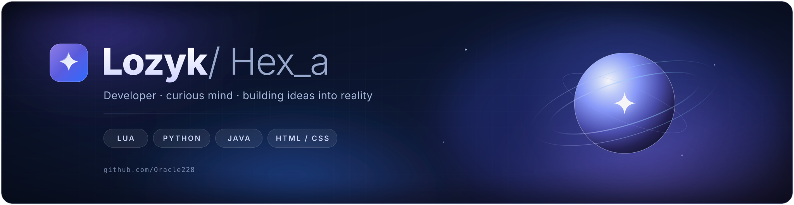

  

  
  
  

 
> https://lozyk-hex-a.pages.dev/
> Developer. I build things, explore ideas, and enjoy figuring out how everything works.

## ⟡ About

- I like interfaces that feel alive — glass, motion, and the small details you notice later.
- Most of my projects start with a question and end as code.
- Right now I'm poking at Lua tooling, Java, and single-file web experiments.

## ⟡ Toolbox

  
  
  
  
  
  

## ⟡ Selected work

Single-file image editor & gallery — plain HTML, CSS and JavaScript, no build step.

## ⟡ GitHub

  
  

  

## ⟡ Contact

| Discord | GitHub |
| --- | --- |
| `code.leak` | [@Oracle228](https://github.com/Oracle228) |

<b>🇷🇺 По-русски</b>

 

**Lozyk / Hex_a** — разработчик. Собираю вещи, разбираюсь, как они устроены, и довожу до состояния, в котором ими приятно пользоваться.

- Люблю интерфейсы, которые ощущаются живыми: стекло, движение, мелкие детали.
- Большинство проектов начинается с вопроса и заканчивается кодом.
- Сейчас копаю Lua-тулинг, Java и одностраничные веб-эксперименты.

**Стек:** Lua · Python · Java · HTML / CSS · Git

**Связь:** Discord `code.leak` · GitHub [@Oracle228](https://github.com/Oracle228)

 

  LOZYK / HEX_A — made for the curious

